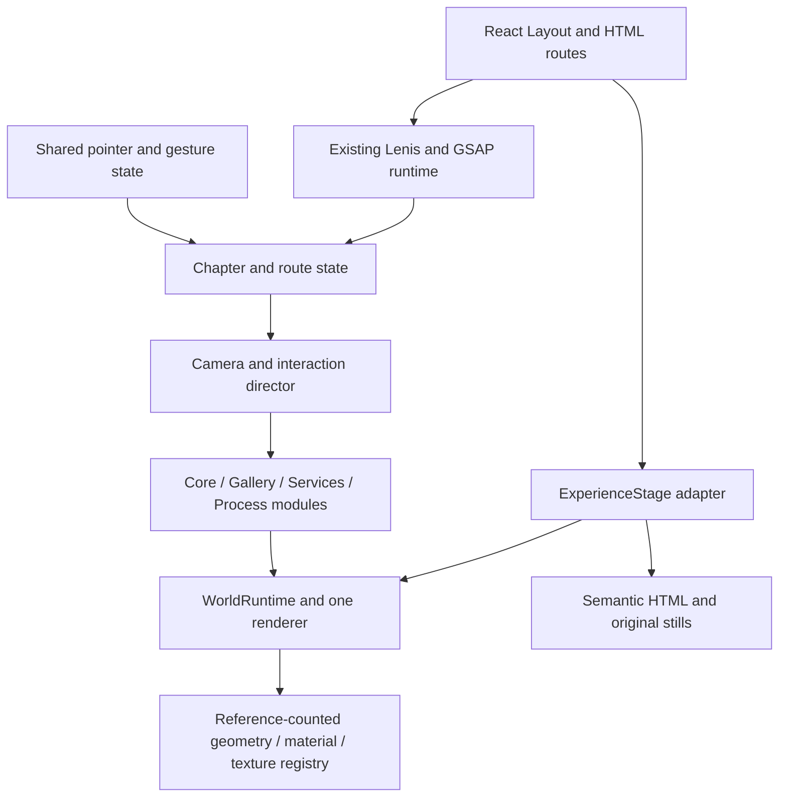

# WEBORA V2 — Technical architecture

10 October 2026. **Proposed architecture; no runtime implementation in Phase1.** Assumes the approved V1 at `3f57b43`. Read the [audit](WEBORA-V2-AUDIT.md) for verified limitations and the [implementation plan](WEBORA-V2-IMPLEMENTATION-PLAN.md) for sequencing.

## 1. Architecture decision

Keep React/Vite/TypeScript, native Three.js, GSAP/ScrollTrigger, Lenis and React Router. There is no demonstrated reason to migrate this working engine to React Three Fiber, Next.js, a new CMS, WebGPU or a different form backend. Avoid dependency/version churn during the creative upgrade.

Recommend a **hybrid HTML + shared native-Three stage**: one renderer/canvas for the active marketing experience, coordinated scene modules and one camera director; semantic DOM sections, controls and fallbacks remain independently usable. Homepage uses one continuous world. Standalone Work/Services/Studio/case-study routes use route-specific compositions through that renderer where needed. Booking/privacy/not-found remain quiet DOM routes; do not initialize WebGL merely to decorate booking.

“Hybrid” describes HTML plus a shared stage, not five concurrent WebGL canvases. It permits scissored embedded views on standalone routes when continuity is unnecessary. Do not introduce simultaneous full-world and isolated hero renderers. During incremental migration select V1 **or** V2 for an entire route; never mount both in production-looking comparisons.

| Option                                            | Benefit                                                            | Cost / risk                                                       | Decision                                    |
| ------------------------------------------------- | ------------------------------------------------------------------ | ----------------------------------------------------------------- | ------------------------------------------- |
| Current isolated canvases                         | Easy local ownership and fallback                                  | Repeated contexts/environment uploads, independent cameras/clocks | Retain only as V1 reference while migrating |
| One monolithic scene file                         | Simple renderer ownership                                          | All assets/logic coupled; poor route cleanup and testability      | Reject monolithic implementation            |
| One renderer with scene modules                   | Shared lighting/assets and true continuity                         | Requires explicit lifecycle, input and camera ownership           | **Use**                                     |
| HTML + shared renderer, scissor where appropriate | Preserves SEO, controls and booking; supports embedded route views | Coordinate conversion/DOM clipping must be explicit               | **Recommended full architecture**           |

## 2. Ownership and proposed files

| Owner                   | Existing integration / proposed addition                                          | Responsibility                                                                                       |
| ----------------------- | --------------------------------------------------------------------------------- | ---------------------------------------------------------------------------------------------------- |
| React layout            | `src/layouts/Layout.tsx`; new `src/three/ExperienceStage.tsx`                     | Mount one route-level stage, pass discrete route/service/process changes, retain accessible controls |
| World runtime           | New `src/three/runtime/WorldRuntime.ts`                                           | Renderer, scene roots, resize, visibility, errors, one render subscriber and resource disposal       |
| Scene contract          | New `src/three/runtime/types.ts`                                                  | Typed scene lifecycle and frame/quality state; no browser-only side effects at import time           |
| Chapter director        | New `src/three/runtime/ChapterDirector.ts`                                        | Camera pose/target/FOV and chapter blending, reversible normalized scroll                            |
| Asset registry          | New `src/three/runtime/AssetRegistry.ts`                                          | Deduplicated texture/geometry/material ownership, readiness, async generation tokens                 |
| Quality policy          | New `src/three/runtime/QualityPolicy.ts`                                          | Capability hints, rolling samples, pixel/effect budgets and fallback decisions                       |
| Core module             | New `src/three/scenes/CoreScene.ts`, `src/three/geometry/weboraW.ts`              | W geometry, intro assembly, full-turn material-ready sculpture                                       |
| Gallery module          | New `src/three/scenes/GalleryScene.ts`, `src/lib/galleryController.ts`            | Curved screen geometry, single project position, active metadata event                               |
| Service/process modules | New `src/three/scenes/ServicesScene.ts`, `ProcessScene.ts`                        | W-derived chapter arrangements responding to discrete content state                                  |
| Material family         | New `src/three/materials/studioAlloy.ts`, `liquidSurface.ts`                      | Original lighting/flow; explicit low/high quality variants                                           |
| Existing adapters       | `Core.tsx`, `Spatial.tsx`, `engine.ts`, `Projects.tsx`, `StudioSections.tsx`      | V1 comparison during staged migration; remove obsolete ownership only after parity                   |
| Motion/input            | Existing `pointer.ts`, `gesture.ts`, `pageMotion.ts`, `useMotion.ts`, `scroll.ts` | Evolve shared infrastructure; preserve anchors, menu and booking exceptions                          |

Keep scene behavior in modules, not a larger `if(kind)` engine. Keep per-frame transforms/uniforms outside React state. React state changes only for discrete selected project, readiness/fallback and accessible content, not camera position.

Conceptual contract (blueprint, not a file to implement in Phase1): `mount(context) → prepare(signal) → update(frameState) → suspend()/resume() → dispose()`. Context contains renderer-independent scene root, assets and quality; modules never create a renderer or install their own global input/RAF. `FrameState` carries seconds/delta, chapter weights, pointer sample, gallery position, service index and process index. A readiness result distinguishes `geometryReady`, `previewReady` and `failed`; renderer creation alone is not full readiness.

## 3. Renderer, scenes and viewport

Use a fixed stage behind HTML, inside an untransformed layout host. Canvas is `aria-hidden` and `pointer-events:none`; interaction is handled by explicit DOM hit regions. Header, form, dialog, disclosure and links stay above it. Reserve section dimensions in HTML before 3D is ready; canvas never determines document height.

Homepage: one world root contains Core/Gallery/Services/Process groups with shared environment/materials. The director blends camera and module weights between section anchors. Only the current and neighboring chapter can draw; later geometry is prepared near entry. HTML reading sections may have all geometry weights zero and the renderer asleep.

Standalone routes: reuse the stage with route configuration, optionally `setViewport`/`setScissor` for a bounded HTML slot. Rects are measured in CSS pixels. For canvas bounds `c` and slot rect `r`, viewport bottom origin is `c.height - (r.bottom - c.top)`; use the full slot viewport for framing and intersected scissor for clipping. Update camera aspect from full slot size, not clipped size. Handle negative/offscreen rects, header occlusion and DPR consistently. Reset scissor/render-target state after every pass. Do not use CSS transformed parents for the fixed canvas.

Use one primary camera pose for homepage continuity. Route/embedded views may use separate camera objects in the same renderer; the director selects them and no independent script writes their transforms. Projection/FOV/look target are authored by breakpoint and then modified by bounded pointer/object interaction. Keep DOM text exclusion rectangles in camera fitting; calculate sculpture bounds rather than assuming one hardcoded `z` fits every aspect ratio.

Three's renderer supports viewport/scissor and exposes render statistics; this does not make a multi-pass design automatically cheap. See [WebGLRenderer](https://threejs.org/docs/pages/WebGLRenderer.html). Set `renderer.info.autoReset=false` only in opt-in local diagnostics to aggregate all passes and reset once per frame. Report counts separately from estimated GPU bytes.

## 4. One clock, deterministic state

Reuse the existing GSAP ticker as the application clock. One coordinator owns hot updates in this order:

1. Advance the single existing Lenis instance, convert ticker seconds to milliseconds correctly.
2. Update ScrollTrigger and write normalized chapter progress; refresh layout only on known invalidations.
3. Smooth pointer coordinates/velocity once; update the active gallery/rotation controller once.
4. Resolve camera and material state from the authoritative scroll/interaction state.
5. Update visible modules and render if dirty, moving or playing the short intro.

Avoid adding a second global RAF for V2. During migration refactor the existing pointer/gallery/engine loops to tick subscribers; do not silently leave old loops attached. GSAP's internal ticker may remain awake for DOM animations or scrolling even when no WebGL draws are needed. The budget is **one scheduled renderer owner, zero settled/hidden GPU draws**, not a false claim that the entire browser has no RAF.

The current Lenis integration already matches its [official GSAP synchronization pattern](https://github.com/darkroomengineering/lenis#gsap-scrolltrigger), except it does not set `lagSmoothing(0)`. Evaluate that setting with background/foreground and stalled-frame tests before adopting it; it is a global clock decision, not an unrelated quick fix. See [GSAP ticker documentation](https://gsap.com/docs/v3/GSAP/gsap.ticker/).

Clamp simulation delta to at most1/30 s after a pause, reset accumulated velocities when resuming, and derive scroll pose from current position rather than integrating missed scroll frames. For 3D chapter state use direct normalized ScrollTrigger progress plus at most **one** chosen response filter. GSAP numeric scrub may still drive independent DOM animations; do not combine scrub, camera lerp and a second scene lerp on the same value.

## 5. Intro lifecycle and continuity

State machine: `disabled → fallback`; otherwise `idle → preparing → playing → handoff → settled`. Any loading failure, route change, Skip, reduced-motion change, early navigation/hash/scroll intent or deadline moves to a settled usable hero/fallback. Guards are idempotent; late callbacks cannot restart the intro.

- Initial React/SSR output includes offer, CTA and a stable original fallback. Show skip from the start of any veil; keep it outside decorative `aria-hidden` trees. Avoid trapping focus or leaving hidden links focusable under the veil.
- `prepare()` creates W geometry/environment, compiles the required material variant and attempts a useful frame. Shader compilation is not a reason to hide content indefinitely.
- Start narrative when ready; never wait merely to fill a loader. If the ≤3 s request deadline would leave too little useful playback, skip to hero.
- Reuse the same W instance and canvas. Handoff updates the director's target camera/object pose, not a second sculpture and renderer. HTML headline appears with a short independent reveal.
- Preserve existing session-awareness semantics; version a new key intentionally (`webora-intro-v3` only if approved), plus in-memory fallback when storage is denied. Intro is not a route-loading mechanism.
- Reduced motion/low capability: no camera travel, fragments, shader-time animation or mandatory intro. A static ready hero is complete functionality.
- Skip cancels intro tween handles and removes overlay within one rendered frame; all outcomes remove scroll lock/veil and release focus appropriately.

## 6. W and material system

Retain the original W outline as the canonical shape. Author bevel/edge widths, front/back seam, rear silhouette and sidewalls so all six inspection directions look deliberate. Build a shared geometry factory with low/medium/high bevel density; reuse geometries across fragments where possible. Use triangulated matching pieces or designed panel segments for assembly, not a fluid solver.

Start with MeshPhysicalMaterial/StandardMaterial alloy and an original small studio-light environment, generated once and shared. A roughness/normal flow is the base liquid impression. Optional vertex displacement must preserve W legibility and silhouette; use consistent normal treatment so lighting follows the displaced surface. If shader chunk customization is used, isolate it, give variants stable program cache keys, and test against the locked Three version. Do not upgrade Three opportunistically.

Initial proposed uniforms: `time`, `chapter`, `assembly`, `pointerLocal`, `dragVelocity`, `flowStrength`, `quality`. Update mutable uniform values; do not rebuild material or geometry during pointer/scroll frames. Keep modulation restrained and bounded. Favor low-octave analytic flow over many-octave noise; no per-pixel iterative raymarching in the base tier.

High-quality controlled refraction is optional: one bounded resolution scene-color target for the material if needed; no recursive world capture, no duplicate transmission and reflection pipelines, no always-on bloom. Test screen content, alpha composition and tone mapping. Mobile/low-power uses opaque alloy with no offscreen refraction pass. Material or shader failure reverts to ordinary alloy, then original DOM/SVG fallback if WebGL fails entirely.

## 7. Full-turn interaction contract

Continue using Pointer Events and the existing horizontal-intent gesture approach. DOM hit region covers the visible core, excludes buttons/links/form controls, and uses `touch-action:pan-y`. Require about7–10 px intent; reject vertical touch intent before capture. A rejected gesture belongs to native scrolling for its lifetime; do not switch ownership midway. Stop/cancel/lost capture and route exit clear drag state. Suppress accidental post-drag clicks while preserving keyboard activation.

Yaw is unbounded; store an unwrapped angle for state/testing, derive a quaternion for rendering. Pitch is limited initially to±25° and softly returns if required. Pointer sensitivity starts near `2π / max(300, .85 × hitWidth)` radians per CSS pixel; tune by device. Estimate velocity from a short time-based window, not only the last event; clamp yaw speed initially to12 rad/s. With seconds as units, released velocity decays `ω *= exp(-dt/0.22)` and angle integrates `θ += ω*dt`; stop below.01 rad/s. These are original tuning seeds, not reference measurements.

Left/right buttons target exact±π/2 turns through the same controller; Reset targets the designed hero angle/pitch. Do not implement button turns as a loosely calibrated impulse. Stop autonomous object rotation when pointer is dragging, controls have focus, menu is open, reduced motion is on, or page is hidden. Full-turn view never rotates the business copy or camera out of the document.

Acceptance: >2π cumulative yaw through real pointer/touch input; six side captures show finished geometry; vertical swipe from the same hit region scrolls naturally; no residual capture or navigation after a drag.

## 8. Gallery geometry, physics and semantics

One authoritative continuous index `q` ranges0…3 from `featuredProjects`. `GalleryController` owns position, velocity, target and mode; `GalleryScene` consumes it without a second damping filter. React receives only discrete `activeIndex` events.

Starting placement for signed offset `d=i-q`: `a=d×0.42`, `x=R×sin(a)`, `z=zFront+R×(cos(a)-1)`, with `R≈8` scene units. This gives real rear recession at±1. Yaw faces each screen toward the arc center; active returns near-front-facing. A small active forward offset≤.3 units may emphasize selection. Tune camera/FOV and screen width together to prevent neighbor overlap; render active±1 primarily, fade/cull further objects. These numbers require visual tuning.

Build a subtly curved subdivided plane (desktop roughly24 horizontal segments, low tier8–12), preserving UV aspect and a flatter central region. Screenshot shader is toneMapped:false so brand colors remain accurate; only frames/edges share world lighting. Never stretch a tall page capture across the screen. Preserve current top-aligned crop semantics and label artwork/placeholder honestly. Reuse actual image assets through `assetUrl()`.

Controller states: `idle`, `dragging`, `settling`, optional `scrollOwned`, `routeExit`. While dragging, pointer delta directly updates q with bounded soft edge resistance; estimate velocity. On release choose `target=clamp(round(q+velocity×.16),0,3)` as a starting projection, then use a critically damped spring (initial stiffness120 s⁻², damping≈22 s⁻¹). Cap velocity and integrate with clamped delta. One owner only: vertical page scroll is not also writing q during manual settling.

Default gallery is **not pinned**. Homepage scroll can reveal/position the gallery world without consuming project index. If desktop testing justifies one short pin later, restrict it to wide/tall fine-pointer devices and ≤1.5 viewport scroll distance total, expose escape/next-section action, and explicitly arbitrate scrollOwned versus drag. No pin on touch, reduced motion, or short landscape. Case-study/home anchors cancel any outstanding scroll-owned target before navigation.

Wheel: never capture ordinary vertical deltas. Horizontal/explicit modifier navigation is optional and prevents default only when the gallery can move; yield at bounds. Arrow keys/Home/End work only when gallery/controls have focus. Number buttons select deterministically, previous/next disable at bounds. Use region/carousel semantics, inert inactive project content, one polite settled announcement and visible focus. Do not move keyboard focus merely because scroll changed the scene.

Metadata: fixed-height HTML region with one outgoing and one incoming presentation at most. Decide the active project at a stable threshold with hysteresis; update status, preview and CTAs atomically. Case link resolves from active project data, never a mesh array index that can drift. Original Article Project panel has no case-study or live link. React Router navigation still succeeds with JavaScript3D enhancement disabled.

## 9. Scroll, camera and route choreography

`ChapterDirector` maps measured HTML section anchors to normalized chapter intervals; do not hardcode one page-height percentage. Cache rects on resize/font readiness/content expansion/ScrollTrigger refresh, then use scroll position for hot sampling. Coalesce refresh requests after disclosures and route load; do not call full refresh per frame.

| Interval                   | Camera/object behavior                                                | Reverse/anchor rule                                                                                |
| -------------------------- | --------------------------------------------------------------------- | -------------------------------------------------------------------------------------------------- |
| Intro→hero                 | Time-driven handoff to the same hero pose                             | Skip lands directly at hero; hash/direct route skips intro                                         |
| Hero exit→work             | W folds recede; camera widens to gallery                              | Pose is a pure function of section progress and bounded interaction state                          |
| Work→services              | Screens retreat; same lighting follows folds                          | No programmatic scroll unless visitor selected a navigation action                                 |
| Services→editorial content | Quiet environment/static geometry                                     | HTML can occupy full width with world asleep                                                       |
| Process                    | Camera tracks six-stage W path; tab choice has priority while focused | Scroll must not override keyboard selection until focus leaves or intentional scroll stage changes |
| Final CTA                  | Low-motion return to W silhouette                                     | Booking route cancels all scene input and intro state                                              |

Keep existing `scrollToAnchor()` header offset, Scroll to Discover behavior and route/hash history semantics. User wheel/touch cancels delayed anchor correction; avoid the current timing workaround multiplying as V2 scenes load. Wait for known layout readiness, refresh once, then correct anchor only if user has not taken control.

On route change cancel gesture, tween and pending scene work; update generation token; revert only that route's GSAP context/matchMedia registrations, kill its pins, restore scroll ownership, then activate destination module. Preserve one Lenis instance across eligible routes; booking continues to bypass smoothing inputs. View Transitions may animate DOM snapshots, but must not double-render old/new worlds or prevent immediate content/navigation fallback.

Do not intercept external links, modified clicks, downloads or provider requests. Back/forward, deep link, refresh and404 recovery must retain existing behavior. Prerender imports must never access WebGL/window at module scope.

## 10. Cursor and pointer physics

Reuse `src/lib/pointer.ts` as a small mutable store, migrated to coordinator ticks. Separate raw target, smoothed screen coordinates, local hit-region normalized coordinates, true event velocity, settled state and semantic context. Current velocity is an error-distance heuristic; V2 can use a short timestamped event window with filtering, resetting on pointer leave/visibility changes.

Cursor is a subscriber writing `transform`/text/CSS variables to a ref, not React per-frame state. Scene light response and shader influence consume that same sample, transformed to local coordinates. Drag mode overrides label and visual feedback. Labels also update on focus/context change so they do not wait for an unrelated pointermove. Read magnetic target rect once on enter/resize, not repeatedly across subscribers. Bound attraction/translation and never modify form/control hit semantics. Disable custom cursor and magnetism for coarse pointers/reduced motion. Keep the OS cursor and focus cues available.

## 11. Loading, caching, cleanup and failure

Only load the Three world on eligible routes when near visibility and motion policy allows. Load current/next chapter geometry and gallery active±1 preview; don't fetch all six models/textures eagerly. Current original geometry needs no GLB/model fetch. If later media is added, keep it same-origin, licensed and routed through `assetUrl()`.

Registry keys include asset URL and quality variant. Track users/refcounts; free per-route resources once released, retain a bounded active/neighbor cache across marketing routes. Async loads carry route/generation tokens. Abort fetch/decode when possible; if the Three loader cannot abort, dispose late returned resources and never mutate a disposed material. Free placeholder textures when replaced and no longer referenced. CPU ImageBitmaps also need explicit close after their users finish.

Render exceptions are isolated: disable failed material/module, preserve semantic fallback, release its owned resources and expose a quiet retry if appropriate. Context loss suspends draws and switches fallback; on restore rebuild once from the current logical state, without replaying intro or changing form state. Repeated loss downgrades to DOM fallback for the session. Track all allocations from the beginning of initialization so an exception before mount completion still cleans up.

On runtime disposal: remove ticker subscriber, input handlers and observer subscriptions; cancel async work/tweens; dispose owned geometry/material/texture/render targets and generated environments; close bitmaps; release context only when that renderer is retired; remove canvas. Do not forceContextLoss on a shared renderer merely because one scene module leaves. Three requires explicit resource disposal; [official cleanup guidance](https://threejs.org/manual/pages/how-to-dispose-of-objects.html) also notes that some internal cached counts persist without constituting a leak.

## 12. Adaptive rendering and measurable targets

These are **proposed acceptance budgets**, not achieved measurements. Tune only against a recorded device/browser and workload. Capability hints include coarse pointer, viewport/aspect, reduced motion, Save-Data, conservative memory/concurrency hints where available, WebGL limits and measured frame behavior. Missing hints do not mean “high power.” Avoid brittle GPU-vendor blacklists.

| Tier                            | Pixel/DPR starting cap           | Features                                                                                | Active / idle policy                                              |
| ------------------------------- | -------------------------------- | --------------------------------------------------------------------------------------- | ----------------------------------------------------------------- |
| High                            | DPR≤1.5,≤1.6M pixel world buffer | Refined bevel/alloy; optional one reduced-resolution refraction pass after budget proof | Aim60 fps during interaction; settle after≤2 s idle               |
| Balanced/touch                  | DPR≤1.0–1.15,≤700k pixels        | Lower geometry, fewer visible surfaces, no refraction/bloom                             | 30 fps render cap where needed; on-demand still after≤1 s idle    |
| Low/software                    | DPR≤.75–1.0,≤350k pixels         | Minimal alloy/flat textures; no timed shader flow                                       | Event-driven rendering; static fallback if interaction stays slow |
| Reduced motion / unavailable GL | No renderer                      | Original SVG/still + HTML content                                                       | No scroll camera/pin/drag animation                               |

Use rolling2 s performance samples, ignoring initial compilation; downgrade after two sustained bad windows. Upgrade only after a long stable interval, at most one tier at a time; avoid oscillation. Exclude background time. Resize on tier change, not every slow frame. Quality changes never alter form values or semantic content.

| Metric                       | Proposed gate                                              | Verification                                                                                    |
| ---------------------------- | ---------------------------------------------------------- | ----------------------------------------------------------------------------------------------- |
| Initial/preloaded JS         | ≤115,000 locally gzipped bytes (baseline101,707)           | Same bundle script; count dynamic world separately                                              |
| Three vendor raw size        | ≤600,000 bytes combined (baseline578,436)                  | Locked build; no second Three copy                                                              |
| Additional V2 world code     | ≤35,000 gzip incremental over baseline                     | Bundle comparison, no new broad animation framework                                             |
| Active frame gaps            | Desktop p95≤20 ms; balanced physical mobile p95≤40 ms      | 60 s scroll/drag runs, foreground, named device; gaps are not GPU time                          |
| Geometry/draw envelope       | ≤100 draw calls/150k triangles high;≤60/60k balanced       | Aggregate renderer.info per presented frame, across all passes                                  |
| Texture allocation estimate  | ≤48 MiB high /24 MiB balanced                              | Decoded dimensions/formats/mips; compressed file size is not VRAM                               |
| Overall tracked GPU estimate | ≤128 MiB high /64 MiB balanced                             | Include buffers, environments, render targets, textures; approximation, not exact driver memory |
| Settled/hidden draws         | 0 after settling;0 while hidden/offscreen                  | Draw counter snapshots and visibility tests                                                     |
| Core Web Vitals              | LCP≤2.5 s, INP≤200 ms, CLS≤.05                             | Lab mobile profile first; field p75 only when real data exists                                  |
| Lifecycle                    | Stable resource plateau over20 route cycles;1 renderer max | Counters + listeners/ticker diagnostics; account for documented caches                          |

Texture byte planning: RGBA8 `width×height×4`, with full mip chain roughly×4/3; frame targets additionally need depth/stencil and samples. A1024² RGBA8 texture with mipmaps is about5.33 MiB regardless of a small WebP download. Disable mips only with deliberate quality tradeoff; use appropriately sized previews/anisotropy. Do not claim exact GPU memory from renderer.info object counts.

Physical-device thermal/battery review requires at least a several-minute interaction/idle run on representative Android/iOS devices. Until performed, explicitly report that boundary. Optimization is continuous from V2.1; V2.5 consolidates it rather than postponing it.

## 13. Business and production invariants

Protected: `StartProject.tsx`, `shared/enquiry.ts`, `services/enquiries.ts`, `draft.ts`, `attribution.ts`, contact/portfolio facts, privacy and SEO behavior. Scene events never import or mutate enquiry state. Do not rewrite draft keys or payloads as part of a renderer migration. Preserve provider variable by reference, never hardcode/expose it in documentation, snapshots or debug output.

Preserve `.github/workflows/pages.yml`, explicit base `/`, canonical `https://webora.design`, prerender list, sitemap/robots and Pages fallback. V2 stays in a separate local worktree until a later explicit release authorization. Local preview can use a blank/mock form setting; intercept all automated Formspree traffic before navigation. Real provider/inbox testing is a separately authorized manual activity, not an acceptance test that sends automatically.

Rendering improvements must degrade to a fully usable marketing and enquiry website, not an error wall. A shader error cannot become a booking outage.
